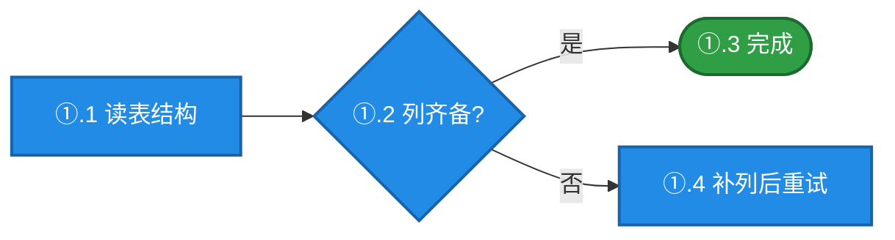

# mermaid-palette

[](LICENSE.txt)
[](refs/palette.md)
[](https://mermaid.js.org/)
[](scripts/check-contrast.mjs)
[](#安装)

> **Mermaid diagrams that carry meaning in color** — a semantic palette with a WCAG contrast gate, so you stop eyeballing whether white text is readable on a colored node.

你写完一张 mermaid 图，配色看起来挺鲜亮，白字也挺精神。
然后有人放大一看：**"①.2 列齐备?" 这几个字根本认不出来。**

因为 `fill:#4dabf7` 上放白字，对比度只有 **2.48**。WCAG 的门槛是 3.0。
这不是审美问题，是可读性问题——而那行字恰好标着流程的判定分支。

这个 skill 把"配色能不能读"从**感觉**变成**可以算的**。

---

## 问题：高饱和 + 白字，几乎全不达标

| 你可能会写的 | 白字对比度 | 判定 | 改成 | 对比度 |
|---|---|---|---|---|
| `fill:#4dabf7,color:#fff` | **2.48** | ❌ | `fill:#228be6` | **3.56** ✅ AA |
| `fill:#51cf66,color:#fff` | **2.01** | ❌ 几乎读不清 | `fill:#2f9e44` | **3.45** ✅ AA |
| `fill:#ff6b6b,color:#fff` | **2.78** | ❌ | `fill:#f03e3e` | **3.84** ✅ AA |
| `fill:#ff922b,color:#fff` | **2.23** | ❌ | `fill:#e8590c` | **3.58** ✅ AA |

**解法：色相不动、白字不动，只把亮度压到能承载白字的程度。**

蓝还是蓝，绿还是绿，红还是红——只是从"荧光"变成"可读"。
**只降一档就够。** 一步压到 `#1864ab` 那种深色，等于把亮色带来的观感全压没了。

---

## 安装

### 方式一：作为 Agent Skill 安装（推荐）

克隆到你的 skills 目录，之后每次对话都会自动可被引用：

```bash
git clone https://github.com/rj-v-shengsongtao/mermaid-palette.git ~/.claude/skills/mermaid-palette
```

**Claude Code** 与 **VS Code Copilot Chat** 都从这里读取技能（Windows 下 `~` 即 `%USERPROFILE%`）。

装完后直接说人话就能触发：

> 帮我给这张流程图配色，别让白字看不清
> 这个 fill/color 组合能读吗
> 统一一下这个项目所有图的配色

### 方式二：只拿色板，不用装

不给 agent 用、只想自己抄色值？跳过安装，直接看
[SKILL.md 的四档速查表](SKILL.md) 或 [refs/palette.md](refs/palette.md) 的 classDef 代码块复制即可。

### 方式三：只用校验脚本

脚本零依赖、纯 Node ESM，`node >= 16`：

```bash
# 临时用（不克隆）
npx https://github.com/rj-v-shengsongtao/mermaid-palette/raw/main/scripts/check-contrast.mjs --palette

# 或克隆后长期用（推荐，可挂进 CI）
git clone https://github.com/rj-v-shengsongtao/mermaid-palette.git
node mermaid-palette/scripts/check-contrast.mjs "#228be6" "#ffffff"
```

### 装到项目里（团队共享）

想让整个团队自动遵守，把 skill 放进项目仓库，而不是只放个人目录：

```bash
mkdir -p .github/skills
git clone https://github.com/rj-v-shengsongtao/mermaid-palette.git .github/skills/mermaid-palette
```

`.github/skills/` 是 VS Code Copilot 工作区级技能目录，跟随仓库走，新人克隆即生效。

### 验证装好了

```bash
node ~/.claude/skills/mermaid-palette/scripts/check-contrast.mjs --palette
```

看到 `✅ 全部色板达标` 就对了。

---

## 快速上手

默认档（B：色相下沉 + 白字）直接复制：

```text
classDef stepB  fill:#228be6,color:#ffffff,stroke:#1864ab,stroke-width:2px
classDef okB    fill:#2f9e44,color:#ffffff,stroke:#1b6b2f,stroke-width:2px
classDef failB  fill:#f03e3e,color:#ffffff,stroke:#c92a2a,stroke-width:2px
classDef warnB  fill:#e8590c,color:#ffffff,stroke:#b23c0c,stroke-width:2px
classDef rollB  fill:#845ef7,color:#ffffff,stroke:#6741d9,stroke-width:2px
classDef dataB  fill:#099268,color:#ffffff,stroke:#087f5b,stroke-width:2px
classDef muteB  fill:#868e96,color:#ffffff,stroke:#495057,stroke-width:2px
```

用法：



---

## 语义映射（色相固定，不随档位变）

| 色相 | 语义 | 白字对比度 |
|---|---|---|
| 蓝 `#228be6` | 主流程 / 步骤 / 入口 | 3.56 |
| 绿 `#2f9e44` | 成功 / 完成 / 通过 / 就绪 | 3.45 |
| 红 `#f03e3e` | 失败 / 阻断 / 高风险 | 3.84 |
| 橙 `#e8590c` | 警告 / 待确认 / 降级 | 3.58 |
| 紫 `#845ef7` | 纠偏 / 回退 / 待决策 | 4.26 |
| 青 `#099268` | 数据 / 存储 / 持久化 | 3.95 |
| 灰 `#868e96` | 中性 / 已弃用 / 边缘 | 3.32 |

同一张图：**同一语义一个色相、≤5 色、强调色 ≤1**。
色相不够用就别硬凑——先减少要区分的东西。

---

## 四档：按场景选，不按喜好选

| 档 | 什么时候用 | 形态 | 白字对比度 |
|---|---|---|---|
| ⭐ **B 色相下沉（默认）** | 一切常规节点 + `subgraph` | 中饱和实心 + 白字 | 3.0+（AA） |
| **A 稳重** | 会被打印 / 对外交付 / 要求醒目大字 | 深饱和实心 + 白字 | 4.5+（全 AA） |
| **C 容器** | **仅超大 subgraph**（内部 ≥10 节点） | 浅底 + 深描边 + 深字 | 6.5+（AAA） |
| **D 亮底** | ⚠️ 仅当明确要"亮底深字" | 高饱和亮色 + 深字 | 5.1+（全 AA） |

**同一张图不混档。** 唯一例外是时序图——它只有 `actor` 能改字色（B 档）、`rect` 只能铺背景（C 档），
混档是被图型逼出来的，不算违规。详见 [refs/palette.md §1.2](refs/palette.md)。

> ⛔ 但**绝不许因为"图型上不了我要的颜色"就换掉图型**。
> 有时序 → `sequenceDiagram`、有分支 → `flowchart`、有状态 → `stateDiagram-v2`。
> 上色是第二层，图型能力不够就在它范围内把颜色用足，别改信息结构去迁就配色。

---

## 校验脚本

```bash
# 校验一对颜色
node scripts/check-contrast.mjs "#228be6" "#ffffff"

# 扫描整个 markdown 里所有 mermaid 代码块内的 style / classDef
node scripts/check-contrast.mjs docs/design.md

# 列出四档色板全部实测值（含反面教材）
node scripts/check-contrast.mjs --palette
```

输出：

```
✅  #228be6  vs  #ffffff  =  3.56:1   AA-large
❌  #4dabf7  vs  #ffffff  =  2.48:1   FAIL
    门禁：图形/大字 ≥ 3，正文标签 ≥ 4.5
    解法：色相不动，只把 fill 亮度压一档
```

退出码：`0` 全过 / `1` 有不达标 / `2` 用法错误——可以直接挂进 CI。

零依赖，纯 Node ESM，`node >= 16` 即可。

---

## 色板是基线，不是天花板

**存下来的目的是让已经证明好看的判断能被复用，不是把后来者锁死。**

| 类型 | 内容 | 能否超越 |
|---|---|---|
| **硬约束** | ① 对比度门禁 ≥3.0/≥4.5 ② 语义映射 ③ ≤5 色 ④ 用户指定色相与字色 | ❌ 不得绕过 |
| **软基线** | 具体 hex、压暗幅度、stroke 深浅、档位选型、布局、留白 | ✅ 有更好方案就换 |

超越要同时满足：**门禁实测仍过 + 语义不变 + 一句话说清为什么更好**。

> ⚠️ "审美提升"不是绕门禁的挡箭牌。亮色好看但白字 2.1 —— 那不叫审美，叫不达标。

---

## 这不是又一个配色主题

Mermaid 自带 `themeVariables`，但主题只给一套**默认**，不告诉你：

- **什么时候该上色**（还是该改用表格）
- **上到什么程度**（全量 / 局部 / 只描边）
- **压到哪个亮度停**（压过头就把观感压没了）
- **图型上不了色时怎么办**（答案是：不许换图型）

这个 skill 补的是**决策**，不只是**色值**。

---

## 文件结构

```
mermaid-palette/
├── SKILL.md                 三条硬规则 · 决策速查 · 自检清单
├── refs/
│   ├── color-decision.md    要不要上色、上多少 · 四条纪律 · 三个反模式
│   └── palette.md           四档完整色值 · 门禁公式 · 语义映射 · 混档例外
└── scripts/
    └── check-contrast.mjs   WCAG 对比度校验（零依赖）
```

## License

MIT
