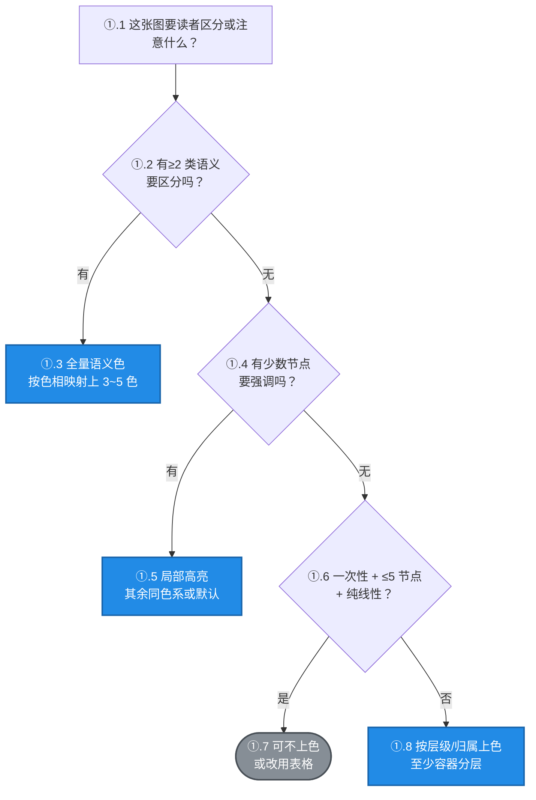

# 要不要上色，上到什么程度

> 上色的价值是**省读者的大脑**，不是省自己的手。
> 一张没上色的流程图，读者要逐个读标签才能建立分类；一张上了对色的图，分类在扫视阶段就完成了。

## 两条独立收益（任一成立就够本）

| 收益 | 含义 | 落空的样子 |
|---|---|---|
| **信息效率** | 分类、轻重、异常在扫视阶段就被读出，不用逐字读 | 全图黑白，读者必须先读完全部标签才知道哪块是重点 |
| **观感舒适** | 上得对的图**看起来舒服，人才愿意看**；纯黑白的密集图容易让人先皱眉头再硬啃 | 信息没损失，但读者心理成本高，扫一眼就划走 |

> 📌 第二条不是"锦上添花"——**读者愿不愿意看，决定了信息能不能传出去**。
> 一张没人愿意细看的图，信息承载力等于零。所以"上色更舒服"本身就是充分理由，不需要额外论证。
> 前提仍是**上得对**：观感舒适来自克制的配色（≤5 色、克制饱和、对比度达标），不是来自堆色。

## 0. 一句话判据

> **这张图需要读者「区分」或「注意」什么吗？**
> 需要 → **上色**（区分 → 全量语义色；注意 → 局部高亮）。
> 只有「一次性口头对齐 + ≤5 节点 + 纯线性」时，才考虑不上色。

## 1. 上色到什么程度（问题不是要不要，是多少）

| 程度 | 什么时候用 | 典型场景 |
|---|---|---|
| **全量语义色（首选）** | 有分类、有分支、有状态、有层级 | 流程图带成败分支、状态机、架构分层、排查因果链 |
| **局部高亮** | 主体单一，只有少数节点要抓眼球 | 一个异常点、一处待确认、一条回边 |
| **仅分组/描边** | 分组已表达结构，只想强化边界 | 大流程套小阶段，节点本身同质 |
| **不上色** | 一次性、纯线性、或该改用表格 | 3~5 节点即时对齐、A→B→C、并列事实 |

## 2. 场景表（默认上色，右列才是例外）

| 场景 | 上色建议 | 具体做法 |
|---|---|---|
| ≥2 类语义要区分 | ⭐ **全量语义色** | 按语义映射上色，色相固定 |
| 有成功/失败/异常分支 | ⭐ **全量或局部** | 正常绿、失败红、告警橙；分支少时可只给异常上色 |
| 状态机 / 生命周期 | ⭐ **全量语义色** | 按状态语义上色（初始/进行/终态/异常） |
| 分层 / 阶段边界 | ⭐ **节点 + 容器都上** | 各层不同色相，容器用同色系撑开归属感 |
| 排查记录 / 根因图 | ⭐ **全量** | 因果链上色（因 vs 果），问题节点强调色 |
| 架构 / 调用链 | ⭐ **全量** | 入口/服务/存储/外部依赖各一色相 |
| 主干 + 多条旁路 | ⭐ **全量或局部单色** | 主干主色，旁路同色系或灰，让主干立起来 |
| 两个立场对照 / 冲突并列 | ⭐ **全量（对立）** | 两框用对立色相 + 中枢/共同点用中性色 |
| 留档 / 对外交付 / 跨会话复用 | ⭐ **全量** | 读者多、寿命长，必要时升 A 档 |
| 纯线性流程 A→B→C（≤5 节点，一次性） | ➖ **可不上色** | 箭头已表达顺序，颜色无新增信息 |
| 3~5 节点的一次性口头对齐 | ➖ **可不上色** | 说完就过，不需要锚点 |
| 并列事实 / 判据 / 对比（≤5 项） | ➖ **改表格**（不是不上色，是不上图） | 表格比彩色图更省更快读 |

> 表里 9 行「⭐ 上色」对 3 行「➖ 可不上色」——**上色是常态，不上色是例外**。

## 3. 上色的四条纪律（防滥用，不防上色）

这四条和"鼓励上色"不冲突——**它们防的是无效上色，不是上色本身**：

| 纪律 | 含义 |
|---|---|
| **色必有意** | 同一色相在整份文档里永远指同一语义；换个图就换意思 → 等同没上色 |
| **≤5 色、强调 ≤1** | 色相多了会相互抵消；真正要突出的只留一个 |
| **过对比度门禁** | 见 [palette.md](palette.md)，3.0 是硬线 |
| **不抢结构** | 框和框内节点别都高饱和，否则读者分不清哪层是判断、哪层是内容 |

## 4. 三个反模式（不是"上色错"，是"这样上色错"）

| 反模式 | 为什么错 | 正确做法 |
|---|---|---|
| **全图同色** | 信息量为零，但**比无色更糟**——颜色暗示了"有含义"，读者会去找规律，找不到就困惑 | 要么按语义分色，要么干脆不上色 |
| **同色异义 / 异色同义** | 同一色在不同图指不同东西，跨图引用时读者必然误读 | 语义映射全局固定，新语义就新增色相 |
| **颜色替代结构** | 本该用 `subgraph` 表达的分组，用颜色暗示，读者分不清"颜色=分组"还是"颜色=状态" | 结构用结构表达，颜色只做叠加增强 |

## 5. 判定流程图

> 🔖 图自己就是示范：三个**上色出口**（C/E/H）用主色，唯一的**不上色出口**（G）用灰——
> 默认路径一眼可见，例外一眼可辨。判定节点保留默认，让颜色只落在结论上。

## 6. 为什么不上色也允许（但别当默认）

不写 `style` 时编辑器渲染默认样式，它确实有三个优势：**对比度天然达标**（白底黑字不用算）、
**亮/暗主题自适应**、**打印不糊**。

但这不是"默认不上色"的理由——它只是"某些场景可以偷懒"的许可。
真正决定要不要上色的，是**这张图有没有信息需要被颜色承载**。

## 7. 一个必须避开的认知陷阱

**「不允许 X」≠「默认非 X」。**

客户说"也不是不允许不上色"，意思是**允许**不上色，不是要求**默认**不上色。
把"许可"读成"默认值"，是最典型的过度矫正：松了约束就反手立成新默认。

同理，被指出"图太多/太花"时，正确反应是**删掉无意义的颜色**，不是**从此不上色**。

## 8. 谁定颜色：用户的审美优先

**配色规范管的是"AI 怎么产出"，不是"用户该喜欢什么"。**

| 情况 | 该怎么做 |
|---|---|
| 你指定了颜色 | 照做。附上实测数字即可，不劝、不改 |
| 你指定了颜色但白字读不清 | 照做 + 说明数字。**要不要换由你定** |
| 你觉得某档太淡/太艳 | 换一档或换 hex，规范里没有"不能用的颜色" |
| AI 觉得换个色更好 | **先问一句**，不许默默替换 |

**AI 的越权才是问题，不是用户的偏好。**
规范如果不小心变成了"AI 借可读性之名改掉用户要的效果"的工具，那它就跑偏了。

> 📌 一句话判据：**用户贴的是规格（照做），用户说的是目标（可发挥）。**

