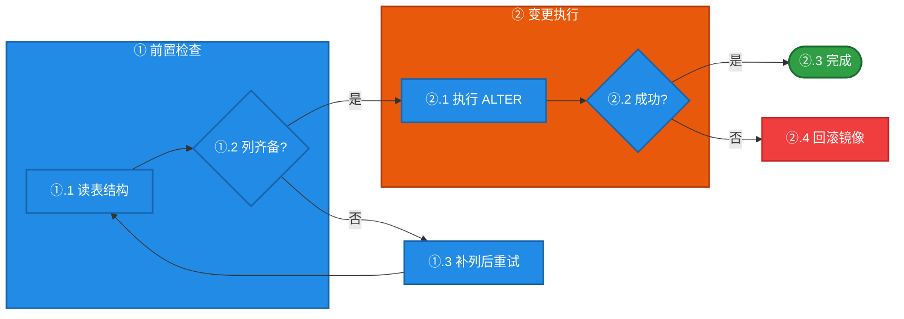
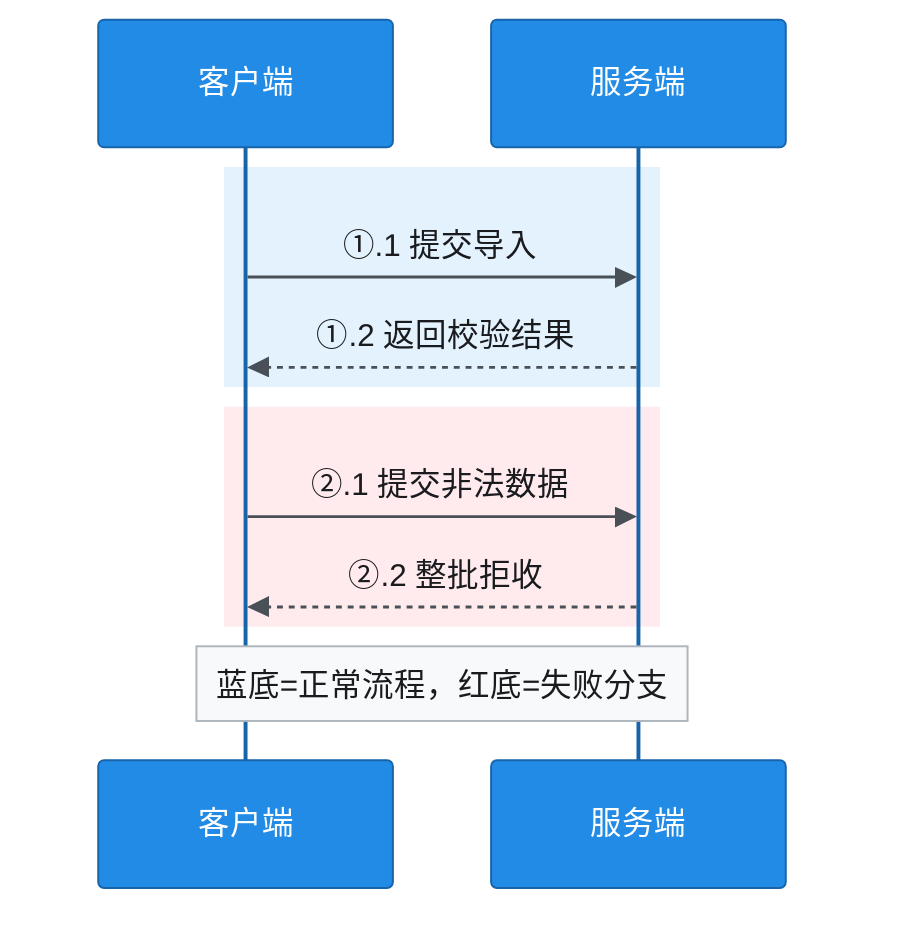

# 配色规范（含对比度门禁）

> **门禁只负责丈量，不负责裁决。** `fill` 上承载文字的 `color`，WCAG 对比度**图形/大字 ≥ 3.0、正文标签 ≥ 4.5**。
> 低于 3.0 时脚本会报出来，附上具体数字——**用不用，你定**。
> 数据由 $L = 0.2126R+0.7152G+0.0722B$（sRGB 线性化后）计算，可用 `../scripts/check-contrast.mjs` 实测。

> 📌 **谁的审美谁做主**：你选的色相和字色，AI 照用。门禁存在的意义是让你**看到代价**（"这样白字只有 2.48"），
> 不是替你否决。真实的禁区只有一个——**AI 悄悄改掉你选的色**。

## 0. 三个高频组合的实测：高饱和 + 白字会读不清

网上流传的"鲜亮配色 + 白字"写法，实测全部不达标：

| 写法 | 白字对比度 | 判定 | **色相下沉后**（⭐ 默认解法） | 白字对比度 |
|---|---|---|---|---|
| `fill:#4dabf7,color:#fff` | **2.48** | ❌ 不达标 | `fill:#228be6` | **3.56** ✅ AA |
| `fill:#51cf66,color:#fff` | **2.01** | ❌ 严重不达标，几乎读不清 | `fill:#2f9e44` | **3.45** ✅ AA |
| `fill:#ff6b6b,color:#fff` | **2.78** | ❌ 不达标 | `fill:#f03e3e` | **3.84** ✅ AA |

**结论**：**色相不改、白字不改，只把亮度压到能承载白字的程度。** 这是最常用的一个解法。\
色相偏好是标尺不是待改进项——蓝还是蓝、绿还是绿、红还是红，只是从"荧光"变成"可读"。

> 压到哪个档由你选，但**默认是刚过 AA 线的 B 档**（3.4~3.8），
> 因为它观感最接近给定的亮色、又不失可读性；A 档（`#1864ab` 等，6.09 AAA）压得太重，只在必要时用。
> 另一条路：改深字 `#1a1b1e`（D 档）——但**白字是常规诉求**，AI 想把白字改成黑字，先问一句。

## 1. 四档色板（⭐ **默认 B 档：色相下沉 + 白字**；同一张图不混档）

### 1.0 先认清：色板是**基线**，不是**天花板**

下面的色值是**已验证可达标的参考起点**，不是"只能用这五个 hex"的白名单。
审美可以超越基线——**本规范存下来的目的，是让已经证明好看的判断能被复用，而不是把后来者锁死**。

| 类型 | 内容 | 谁受约束 |
|---|---|---|
| **硬约束（约束 AI，不约束你）** | ① 对比度门禁：图形/大字 ≥ 3.0，正文标签 ≥ 4.5（**实测告知，不替你否决**）<br/>② 语义映射：蓝=主流程、绿=成功、红=失败、橙=警告、紫=纠偏（同图不换语义）<br/>③ 同图 ≤5 色、强调色 ≤1<br/>④ 你指定的色相与字色（**AI 要改先问**） | ❌ AI 不得绕过 |
| **软基线（可越）** | 具体 hex 值、压暗幅度、`stroke` 深浅、档位选型、节点形状/布局、间距与留白 | ✅ 有更好方案就换 |

**超越基线要同时满足三条（缺一不可）：**

1. **门禁仍过** —— 拿 WCAG 公式实测，不靠"看着差不多"；
2. **语义不变** —— 色相承载的含义不换，图读者不会因此误读；
3. **一句话说明为什么更好** —— 交付时就地说清（如"这两类节点语义不同，用青/蓝两色区分比同色深浅更清楚，实测白字 3.9 / 3.6 均达标"）。

> 📌 **门禁是告知，不是审批。** 它输出的是实测数字，不是"能不能用"的裁决。
>
> - **你想用亮色 + 白字** → 照做，附一句实测值（"`#4dabf7` + 白字 = 2.48，低于 3.0 门线"）。
>   **决定权在你**，你的审美优先——你要的就是那个亮，那就给那个亮。
> - **AI 自己想改你的色相或字色** → 先问一句，别默默"优化"。这才是真正的禁区：
>   不是用户越界，是 **AI 越权**。
>
> 用户有审美自由，数字也是客观事实——两者并列摆出来就够了，不需要谁去否决谁。

### 1.1 档位与色值

> ⭐ **默认就是 B 档：把给定的亮色调到刚好能承载白字的亮度（AA 3.4~3.8）。**
> 例：`#4dabf7 → #228be6`、`#51cf66 → #2f9e44`、`#ff6b6b → #f03e3e`。
> **默认不从浅底（C 档）起手**——浅底图发白、没重点、要靠描边硬找边界，是典型的"看着安全实际没信息"；
> **也默认不一下压到 A 档**（`#1864ab`）——那会把要的亮色观感全压没。
> （两条都是默认引导，不是禁令；有更好的方案按 1.0 那三条走。）

| 档 | 用途 | 形态 | 白字对比度 |
|---|---|---|---|
| ⭐ **B 色相下沉（默认）** | 一切常规流程图/架构图的**节点 + subgraph**；屏幕阅读、文档、排查记录 | 中饱和实心 + **白字** | 3.0+（AA，实测 3.4~4.3） |
| **A 稳重档** | 退让条件：① 会被**打印**成纸质；② 对外交付（客户/审计）；③ 明确要求醒目大字 | 深饱和实心 + 白字 | 4.5+（全 AA，个别 AAA） |
| **C 容器档** | **仅超大 subgraph**（内部节点 ≥10 或整图 >15 元素） | 浅底 + 深同色系描边 + 深字 | 6.5+（AAA）+ 描边 vs 底 ≥ 3.0 |
| **D 亮底档** | ⚠️ 非常规。仅当明确说要"亮底深字"才用 | 高饱和亮色实心 + 深字 `#1a1b1e` | 5.1+（全 AA，多数 AAA） |

> **默认组合：B 档节点 + B 档 subgraph**（同色系、白字）。
> **约定：指定了 `color:#fff` 就照用**——AI 想改字色，先问一句再动。

```text
%% 档 B 色相下沉（⭐ 默认档：白字 AA 3.4~4.3，屏幕观感与可读性平衡，可直接复制）
classDef stepB  fill:#228be6,color:#ffffff,stroke:#1864ab,stroke-width:2px
classDef okB    fill:#2f9e44,color:#ffffff,stroke:#1b6b2f,stroke-width:2px
classDef failB  fill:#f03e3e,color:#ffffff,stroke:#c92a2a,stroke-width:2px
classDef warnB  fill:#e8590c,color:#ffffff,stroke:#b23c0c,stroke-width:2px
classDef rollB  fill:#845ef7,color:#ffffff,stroke:#6741d9,stroke-width:2px
classDef dataB  fill:#099268,color:#ffffff,stroke:#087f5b,stroke-width:2px
classDef muteB  fill:#868e96,color:#ffffff,stroke:#495057,stroke-width:2px
```

> **色相下沉对照表（给什么色相就压什么色相，不换色相）**：
>
> | 原亮色 | 白字对比度 | → 下沉色 | 下沉后 | 说明 |
> |---|---|---|---|---|
> | `#4dabf7` 蓝 | 2.48 ❌ | `#228be6` | 3.56 ✅ | 必须下沉 |
> | `#51cf66` 绿 | 2.01 ❌ | `#2f9e44` | 3.45 ✅ | 必须下沉 |
> | `#ff6b6b` 红 | 2.78 ❌ | `#f03e3e` | 3.84 ✅ | 必须下沉 |
> | `#ff922b` 橙 | 2.23 ❌ | `#e8590c` | 3.58 ✅ | 必须下沉 |
> | `#9775fa` 紫 | 3.36 ✅ | `#845ef7` | 4.26 ✅ | **本来就过线**，嫌贴线才下沉 |
>
> 下沉幅度：**只降一档亮度就够**，不要一步跨到 `#1864ab`/`#1b6b2f` 这种 AAA 深色（那是 A 档）。
> 紫那行是反面提醒：**先实测再下沉**——`#9775fa` 白字 3.36 本就达标，凭印象把它当"不达标"是浪费一次改动。

```text
%% 档 A 稳重（退让档：白字 AAA，仅打印 / 对外交付 / 要求醒目时用）
classDef stepA  fill:#1864ab,color:#ffffff,stroke:#0b4f8a,stroke-width:2px
classDef okA    fill:#1b6b2f,color:#ffffff,stroke:#124d21,stroke-width:2px
classDef failA  fill:#e03131,color:#ffffff,stroke:#a61e1e,stroke-width:2px
classDef warnA  fill:#b23c0c,color:#ffffff,stroke:#8a2d09,stroke-width:2px
classDef rollA  fill:#7950f2,color:#ffffff,stroke:#5f3dc4,stroke-width:2px
classDef dataA  fill:#087f5b,color:#ffffff,stroke:#066a4c,stroke-width:2px
classDef muteA  fill:#495057,color:#ffffff,stroke:#343a40,stroke-width:2px
```

```text
%% 档 C 容器（仅超大 subgraph；浅底+深边+深字，描边 vs 底 ≥3.0）
classDef grpBlue  fill:#E3F2FD,color:#0b4f8a,stroke:#1864ab,stroke-width:2px
classDef grpGreen fill:#E8F5E9,color:#124d21,stroke:#1b6b2f,stroke-width:2px
classDef grpWarn  fill:#FFF3E0,color:#8a2d09,stroke:#b23c0c,stroke-width:2px
classDef grpRoll  fill:#F3E5F5,color:#4a2a9e,stroke:#7950f2,stroke-width:2px
classDef grpFail  fill:#FFEBEE,color:#a61e1e,stroke:#e03131,stroke-width:2px
```

```text
%% 档 D 亮底（⚠ 非常规：只有确定要用高亮度屏幕观感时才用，且此档禁 color:#fff）
classDef stepD  fill:#4dabf7,color:#1a1b1e,stroke:#1c7ed6,stroke-width:2px
classDef okD    fill:#51cf66,color:#1a1b1e,stroke:#2f9e44,stroke-width:2px
classDef failD  fill:#ff6b6b,color:#1a1b1e,stroke:#e03131,stroke-width:2px
classDef warnD  fill:#ff922b,color:#1a1b1e,stroke:#e8590c,stroke-width:2px
classDef rollD  fill:#9775fa,color:#1a1b1e,stroke:#6741d9,stroke-width:2px
classDef dataD  fill:#20c997,color:#1a1b1e,stroke:#087f5b,stroke-width:2px
classDef muteD  fill:#adb5bd,color:#1a1b1e,stroke:#868e96,stroke-width:2px
```

> ⚠️ 旧色板缺陷已修正：橙 `fill:#FFF3E0,stroke:#F57C00` 的边 vs 底仅 **2.47**、边 vs 白仅 **2.7**，
> 容器边界在浅色/投影场景会糊成一片——已换成 `stroke:#b23c0c`（vs 底 6.77）。

### 1.2 图型能力上限 → 混档的唯一默许例外（⭐ 时序图专用）

**「同图不混档」管得住的是你的选择，管不住图型的元素清单。**
`sequenceDiagram` 只提供三类可着色元素，且能力不重叠：

| 元素 | 上色手段 | 能改字色吗 | 归哪档 |
|---|---|---|---|
| `participant` 参与者头 | `themeVariables.actorBkg` / `actorTextColor` | ✅ 能 | **B 档实心块 + 白字** |
| `rect rgb(...)` 时间段 | 只能铺**背景**，改不了框内文字色 | ❌ 不能 | **C 档浅底**（它本就是「容器」） |
| `Note over` 备注 | `noteBkgColor` / `noteTextColor` | ✅ 能 | 中性灰，**别用语义色** |

**所以时序图的正确配法是「B 档 actor + C 档 rect」，这种混档是被图型逼出来的，不算违规。**

**唯一正确写法**（把 `themeVariables` 一次配全，别只配一半）：

```text
%%{init: {'theme':'base','themeVariables':{
  'actorBkg':'#228be6','actorTextColor':'#ffffff','actorBorder':'#1864ab',
  'signalColor':'#495057','signalTextColor':'#1a1b1e',
  'noteBkgColor':'#f8f9fa','noteBorderColor':'#adb5bd','noteTextColor':'#1a1b1e',
  'labelBoxBkgColor':'#f1f3f5','labelTextColor':'#1a1b1e'
}}}%%
```

**四条纪律**（补在图型限制之上，别拿"图型受限"当全部借口）：

1. **语义靠 `rect` 承载**：正常的段用 `rgb(227,242,253)` 蓝底、出问题的段用 `rgb(255,235,238)` 红底、后果/警告用 `rgb(255,243,224)` 橙底——**这三色是 C 档容器色，不是实心节点色**，别说它「没按 B 档来」。
2. **`Note` 底色建议中性**（`#f8f9fa`）。`noteBkgColor` 是全局的，一改所有 Note 都变色——设成橙/红等于把所有备注都涂成"警告"，语义会串。要区分轻重，让 Note 落在对应 `rect` 里，**靠背景带承载颜色，靠位置承载归属**。
3. **`participant` 默认用 B 档（`#228be6` 等）**：A 档 `#1864ab` 是打印/对外交付的退让档，不是时序图的默认起手；确需更凝重要先说明理由。
4. **`signalColor` 用灰 `#495057`，`signalTextColor` 深字 `#1a1b1e`**：箭头是连线不是信息块，抢颜色没意义。

> 📌 **一条比上面更重要的纪律：别为了上色去换图型。**
> 选图型的第一依据是**要表达什么**——有参与者、有时间先后 → `sequenceDiagram`；
> 有分支判定 → `flowchart`；有状态流转 → `stateDiagram-v2`。
> 上色是第二层的事，图型能力不够就**在它能力范围内把颜色用足**，而不是改信息结构去迁就配色。
> 把时序图换成 flowchart，等于为了上色丢掉"谁在何时做了什么"——**本末倒置**。
> （这条约束的是 AI 的图型选择，不是你的色相偏好；你想要的颜色不管能不能上，图型都别动。）

## 2. 语义映射（色相固定，不随档位变）

| 色相 | 语义 | 典型节点 |
|---|---|---|
| 蓝 | 主流程 / 步骤 / 入口 | 主干步骤、起点 |
| 绿 | 成功 / 完成 / 通过 / 就绪 | 终态、校验通过 |
| 红 | 失败 / 阻断 / 高风险 | 报错、熔断、禁止 |
| 橙 | 警告 / 待确认 / 降级 | 兜底、待对齐口径 |
| 紫 | 纠偏 / 回退 / 待决策 | 回边、重跑、预防节点 |
| 青 | 数据 / 存储 / 持久化 | 表、库、落盘 |
| 灰 | 中性 / 已弃用 / 边缘 | 旁路、历史路径 |

同一张图内，**同一语义只有一个色相**；**≤5 色**；强调色**≤1 个**。

> 📌 这张表列的是**已经占用过的语义**，不是封闭枚举。需要新维度（如"外部系统""人工干预"）时，
> 可以新增色相（避开已有语义、仍 ≤5 色、白字实测 ≥3.0），并在图下批注里说明它的含义。

## 3. 自检清单（画完过一遍）

- [ ] 每个 `fill` 上的 `color` 对比度 ≥ **3.0**（AA 线，B 档的日常门槛）；承载正文信息的标签 ≥ 4.5
- [ ] **白字是默认字色**；指定了 `color:#fff` 就照用，AI 要改先问
- [ ] 为保白字而压暗底色时，**色相仍是原来那个**（蓝→蓝，不要变成紫）
- [ ] **压暗幅度够了就停**：过了 3.0 就不要再往下压，一步跨到 AAA 深色等于把要的亮色观感压没了
- [ ] 容器 `fill` 与 `stroke` 对比度 ≥ 3.0（否则边界看不见等于没分组）
- [ ] 色相语义与上表一致，同图 ≤5 色、强调色 ≤1
- [ ] **图型没选反**：时序图就是 `sequenceDiagram`、有分支就是 `flowchart`——**颜色不够也别改图型**（见 §1.2）
- [ ] 混档只允许一种情况：时序图的 `rect`(C 档) + `actor`(B 档)，其余一律同档
- [ ] **是否真有必要退到 C 档浅底？** 默认 B 档实心色块；C 档只给 ≥10 节点的超大 subgraph
- [ ] **反向自检（防死背色板）**：我是不是只是机械照抄了基线色值？这张图的信息重心，
      有没有更好的表达（换色相区分语义 / 改深浅拉开层次 / 去个多余颜色 / 加留白）？
      有就换，同时走 1.0 那三条（门禁过 + 语义不变 + 说明理由）。

## 4. 示例（⭐ 默认 B 档：色相下沉 + 白字，可直接对照）



时序图配法（B 档 actor + C 档 rect）：


